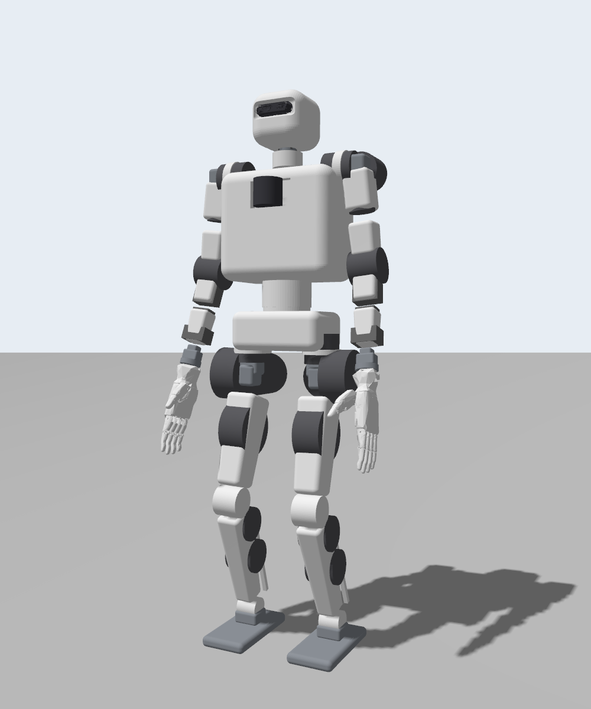

# MIDIBOT

A 1.31 m, 39 kg humanoid robot with 41 actuated joints, simulated in ROS 2 Jazzy and Gazebo Harmonic.

| Posed (Phase 1) | Balancing in its ready stance (Phase 2) |
|---|---|
|  |  |

MIDIBOT is split into two units:

1. **Locomotion & Movement Unit**: legs, arms, waist, head and 5-finger hands; real-time control, ZMP walking
   and the safety supervisor. Runs on the Intel NUC in the pelvis (ROS namespace `/loco`).
2. **AI Unit**: perception, SLAM, manipulation planning, speech and an LLM task planner. Runs on the
   Jetson AGX Orin in the chest (ROS namespace `/ai`).

See [docs/PLAN.md](docs/PLAN.md) for the design plan and roadmap, and [docs/MASS_BUDGET.md](docs/MASS_BUDGET.md)
for the mass breakdown and actuator assignment.

## Status

| Phase | State |
|---|---|
| 1. Model: CAD, meshes, URDF, mass properties | ✅ done |
| 2. Control: torque-mode joint control, standing balance, push recovery | ✅ done |
| 3. ZMP walking | next |
| 4. AI Unit: sensors, SLAM, navigation, grasping | planned |
| 5. Integration: command → LLM planner → behaviour tree | planned |

## Repository layout

```
src/
├── midibot_cad/          # CadQuery structure, vendor CAD fetcher, URDF generator (not a ROS package)
├── midibot_description/  # URDF/Xacro, meshes, ros2_control + controller config
├── midibot_gazebo/       # Gazebo world, sim launch, bridge config, check + snapshot tools
└── midibot_control/      # control nodes: balance controller, hand coupler (walking comes in Phase 3)
```

## Quick start (Ubuntu 24.04, ROS 2 Jazzy)

Install the dependencies:

```bash
sudo apt install ros-jazzy-ros-base ros-jazzy-ros-gz ros-jazzy-gz-ros2-control ros-jazzy-ros2-control ros-jazzy-ros2-controllers ros-jazzy-xacro ros-jazzy-robot-state-publisher ros-jazzy-joint-state-publisher ros-jazzy-rviz2 python3-colcon-common-extensions
```

Build:

```bash
source /opt/ros/jazzy/setup.bash
colcon build --symlink-install
source install/setup.bash
```

Run the simulation (`headless:=false` opens the Gazebo GUI):

```bash
ros2 launch midibot_gazebo sim.launch.py headless:=false
```

The robot crouches into its ready stance and the balance controller takes over. In a second terminal,
run the Phase 2 acceptance test (quiet stance, then 60 N pushes for 0.2 s from four directions):

```bash
ros2 run midibot_gazebo push_test.py
```

The Phase 1 model check expects the zero pose, so it runs with the balance controller off:

```bash
ros2 launch midibot_gazebo sim.launch.py balance:=false
```

```bash
ros2 run midibot_gazebo check_model.py
```

Optional: download the official vendor CAD (motors, lidar) for realistic visuals, then launch with
`vendor_meshes:=true`. See [src/midibot_cad/COMPONENTS.md](src/midibot_cad/COMPONENTS.md).

```bash
python3 src/midibot_cad/scripts/fetch_vendor_cad.py
```

## Interfaces

| Topic / action | Type | Unit |
|---|---|---|
| `/loco/mode` | `std_msgs/String`: `stand` (ready stance + balance) or `zero` | balance controller |
| `/loco/status` | `std_msgs/String`: `WAIT_STATE`, `TRANSITION`, `BALANCING`, `FALLEN` | balance controller |
| `/loco/com`, `/loco/cop`, `/loco/support_center` | `geometry_msgs/PointStamped` (gravity-aligned pelvis frame) | balance controller |
| `/body_controller/reference` | `control_msgs/MultiDOFCommand` (all 29 body joints; position + velocity) | torque-mode joint PD; written by the balance controller |
| `/loco/{left,right}_hand/command` | `std_msgs/Float64MultiArray` (6 values: thumb yaw, thumb pitch, index, middle, ring, pinky) | hands |
| `/joint_states` | `sensor_msgs/JointState` | all 53 joints |
| `/imu_sensor_broadcaster/imu` | `sensor_msgs/Imu` | pelvis IMU |
| `/loco/{left,right}_foot_ft` | `geometry_msgs/WrenchStamped` | ankle force/torque |
| `/ai/camera/{image,depth,camera_info}` | `sensor_msgs/Image`, `CameraInfo` | head RGB-D |
| `/ai/lidar/points` | `sensor_msgs/PointCloud2` | chest lidar |

## License

**Proprietary. All rights reserved.** See [LICENSE](LICENSE). No use, copying or distribution without
the copyright holder's written permission.

Third-party material (Inspire hand meshes, BSD-3-Clause; RealSense mesh, Apache-2.0) stays under its own
license; see [THIRD_PARTY_NOTICES.md](THIRD_PARTY_NOTICES.md). Vendor STEP files are downloaded by each user
and never redistributed.
